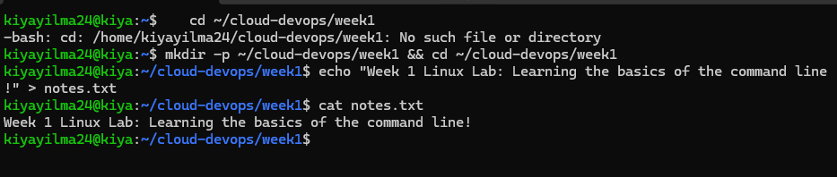
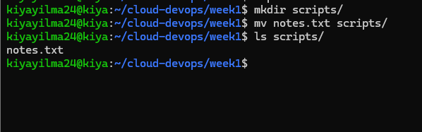
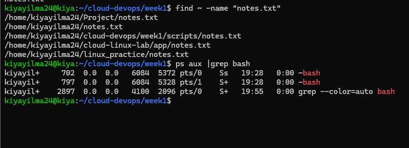

# Week 1 Linux Hands-on Lab

Welcome to my Week 1 Linux project workspace! This repository documents my completion of the foundational Linux command-line tasks.

## 📋 Tasks Completed

### Tasks 1-3: Directory Creation, File Creation, and Adding Text
- Created the `~/cloud-devops/week1` directory.
- Created `notes.txt` and added text using `echo`.
- **Commands:** `mkdir -p`, `echo`, `cat`

---

### Tasks 4-5: Directory Creation and Moving Files
- Created a `scripts` subdirectory.
- Moved `notes.txt` into the `scripts/` directory.
- **Commands:** `mkdir`, `mv`, `ls`

---

### Tasks 6-7: Searching and Process Management
- Searched for `notes.txt` across the home directory.
- Identified a running process (`bash`) and its PID.
- **Commands:** `find`, `ps aux | grep`

---

## 🚀 Reflection
This lab helped me build a solid foundation in Linux navigation, file manipulation, and process management, preparing me for my journey in Cloud and DevOps engineering.
